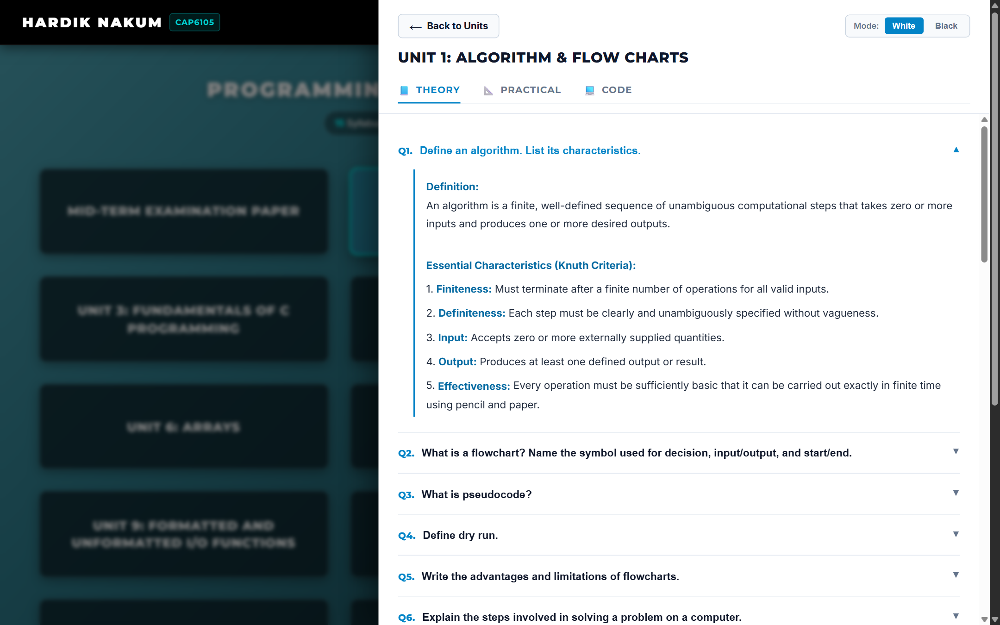
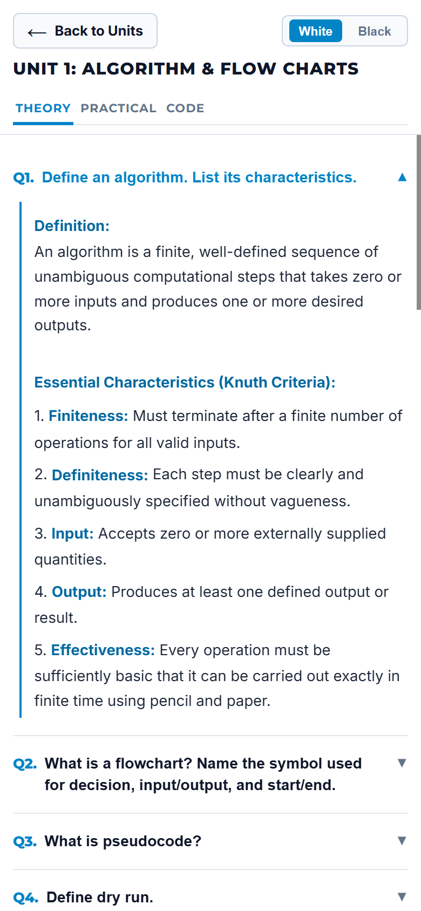
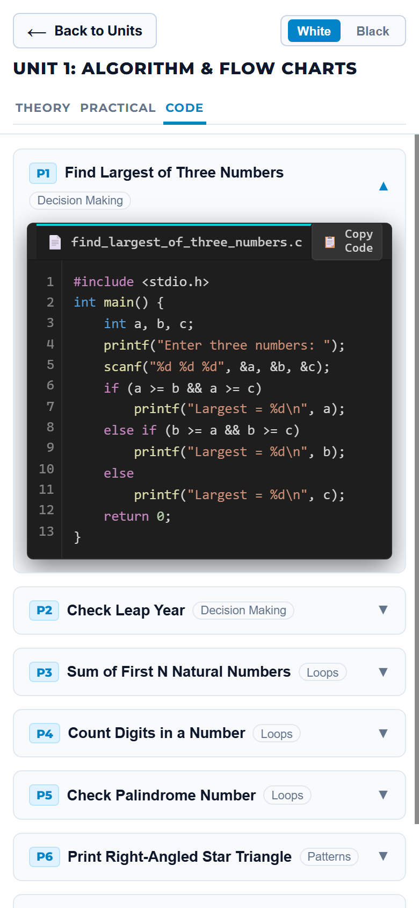

# CAP6105: Programming & Problem-Solving Using C

> **University Examination Study Portal & Interactive Program Library**  
> Developed & Curated by **Hardik Nakum**  
> 🌐 **Live Website**: [https://nakumhardik94.github.io/c-programming-study-portal/](https://nakumhardik94.github.io/c-programming-study-portal/)

---

## 📸 Previews & Screenshots

### Desktop View
| Dashboard & Unit Overview | Interactive Side Panel Reader |
| :---: | :---: |
|  |  |

### Mobile Responsive View
| Mobile Home Screen | Theory & Syntax Highlighter | VS Code Program Drawer |
| :---: | :---: | :---: |
|  |  |  |

---

## 📖 Overview

A complete, distraction-free, exam-oriented study platform for university students preparing for **Programming & Problem-Solving Using C (CAP6105)**.

The portal covers the entire university syllabus across **15 Units**, pairing theoretical concepts with verified examination-level answers, step-by-step algorithms, trace tables, formulas, and an executable library of 65 C programs.

---

## ✨ Features

- **📱 100% Mobile & Tablet Responsive**:
  - Automatically adapts from a 3-column desktop grid to single-column phone layout.
  - Full-screen native reading experience on mobile with clean touch-friendly navigation.
  - Zero horizontal overflow on devices down to 320px.
  - Quick `← Back to Units` button for easy one-handed navigation on phones.

- **📚 15 Syllabus Units & Mid-Term Exam Section**:
  - Unit 1: Algorithm & Flow Charts
  - Unit 2: Keywords, Variables & Data Types
  - Unit 3: Fundamentals of C
  - Unit 4: Operators & Expressions
  - Unit 5: Control Constructs
  - Unit 6: Arrays & Matrices
  - Unit 7: Type Casting
  - Unit 8: Storage Classes
  - Unit 9: Formatted and Unformatted I/O Functions
  - Unit 10: Functions & Recursion
  - Unit 11: Pointers
  - Unit 12: Strings
  - Unit 13: Structure and Union
  - Unit 14: Data Structures: Stack and Queue
  - Unit 15: Dynamic Memory Allocation
  - Dedicated **Mid-Term Examination Paper** Section

- **💡 695+ Exam-Oriented Theory Q&As**:
  - Organized directly by unit without difficulty fragmentation.
  - Single-question accordion: clicking any question expands its answer while cleanly folding others.
  - Clear, readable code writeups with line numbers and one-click code copy.

- **🎛️ Resizable Side Panel Reader**:
  - Interactive drag handle allowing desktop users to adjust reading panel width smoothly.
  - Header Navigation Bar style tabs: `📘 THEORY`, `📐 PRACTICAL`, and `💻 CODE`.

- **🌓 Dual Reading Themes (White / Black)**:
  - Default clean white background with high-contrast text designed for long study sessions.
  - Instant live toggle between **White** and **Black** reading modes with zero page reload.

- **💻 30 Practical Lab Problems & 65 Executable Programs**:
  - Visual Studio Code Dark+ style syntax-highlighted C code with line numbers, gutter, and copy functionality.

---

## 🚀 Live Demo & Usage

- **Live URL**: Hosted on GitHub Pages: [https://nakumhardik94.github.io/c-programming-study-portal/](https://nakumhardik94.github.io/c-programming-study-portal/)
- **Run Locally**: Clone or download this repository, then double-click `index.html` to open it in any web browser.

---

## 👨‍💻 Author

**Hardik Nakum**  
*Data Analyst & Web Developer*  
- GitHub: [@nakumhardik94](https://github.com/nakumhardik94)
