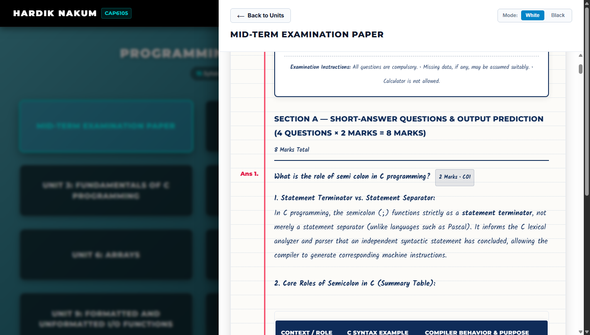
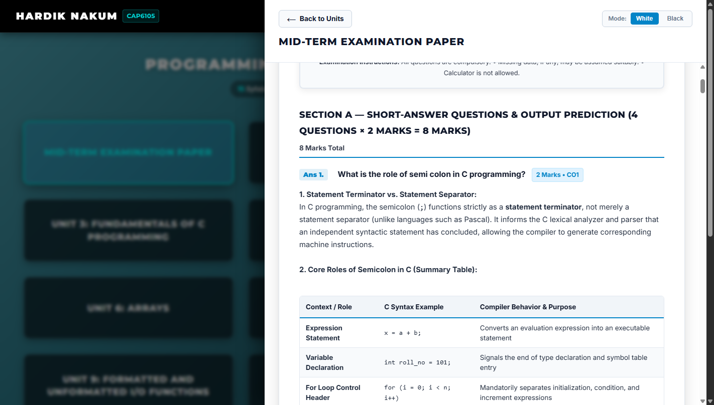

# CAP6105: Programming & Problem-Solving Using C

> **University Examination Study Portal & Interactive Program Library**  
> Developed & Curated by **Hardik Nakum** (Reg. No: 2602030097)  
> 🌐 **Live Website**: [https://nakumhardik94.github.io/c-programming-study-portal/](https://nakumhardik94.github.io/c-programming-study-portal/)

---

## 📸 Previews & Screenshots

### ✍️ Solved Mid-Term Examination Paper (Continuous Handwritten Answer Script Format)
| Authentic Ruled Handwritten Script | Clean Typed Examination Mode | Original Question Paper Photo (Enhanced Scan) |
| :---: | :---: | :---: |
|  |  |  |

### 💻 Desktop Portal View
| Dashboard & Unit Overview | Interactive Side Panel Reader |
| :---: | :---: |
|  |  |

### 📱 100% Mobile Responsive View
| Mobile Home Screen | Theory & Syntax Highlighter | VS Code Program Drawer |
| :---: | :---: | :---: |
|  |  |  |

---

## 📖 Overview

A complete, distraction-free, exam-oriented study platform for university students preparing for **Programming & Problem-Solving Using C (CAP6105)** at **Manipal University Jaipur (Department of Computer Applications - MCA)**.

The portal covers the entire university syllabus across **15 Units**, pairing theoretical concepts with verified examination-level answers, step-by-step algorithms, trace tables, formulas, and an executable library of 65 C programs.

---

## 🏛️ Manipal University Jaipur Mid-Term Examination Paper (Jul–Nov 2026, 30 Marks)

The Mid-Term Examination Paper is rendered in a **continuous handwritten examination answer script format** (college ruled paper, vertical red margin, blue ink typography, question tags, and unbroken flowing answers):

- **🎯 Dedicated 4-Option Toolbar**:
  1. **📥 Download Paper**: Generates clean, printable multi-page A4 PDF of the complete solved examination script via `@media print`.
  2. **✍️ Handwritten**: Authentic college ruled examination answer paper with vertical red margin, blue gel pen ink typography, question tags, and comparison tables.
  3. **🖨️ Text Written**: Clean, modern typography mode for fast reading on any device.
  4. **📷 Paper Photo**: Opens full-screen view of the original enhanced question paper scan.

- **Complete Solved Sections (Not Separated - Flowing Continuous Script)**:
  - **SECTION A (8 Marks):**
    - **Q1 [2M, CO1]:** Role of Semicolon in C (Statement terminator vs. separator, lexical analyzer role, syntax rules).
    - **Q2 [2M, CO1]:** Differentiate between Declaration and Initialization (side-by-side comparison table, memory allocation timing, garbage values).
    - **Q3 [2M, CO2]:** Output Prediction of for loop with break (`if (i == 6) break;`) &rarr; Iteration trace table and boxed output: `1 2 3 4 5`.
    - **Q4 [2M, CO2]:** Output Prediction of operators (`++a`, `b--`, `a, b`) &rarr; Step-by-step pre/post operator evaluation and boxed output: `6 10 6 9`.
  - **SECTION B (15 Marks):**
    - **Q5 [5M, CO1]:** Why Sequence, Selection, and Iteration are fundamental control structures (Böhm-Jacopini Theorem, ASCII flowchart representations, single-entry/single-exit architecture).
    - **Q6 [5M, CO2]:** Analysis of Entry-controlled vs. Exit-controlled loops and comprehensive justification of why `do-while` is ideal for menu-driven applications.
    - **Q7 [5M, CO3]:** Importance of Data Types and Type Conversion (classification, type promotion hierarchy ladder, explicit typecasting syntax & precision safety).
  - **SECTION C (7 Marks):**
    - **Q8 [7M, CO2]:** Full menu-driven banking C application starting with ₹10,000 balance (`1. Check Balance`, `2. Deposit`, `3. Withdraw`, `4. Exit`), switch statement, overdraft protection, input validation, and execution transcript.

---

## ✨ Portal Features

- **📱 100% Mobile & Tablet Responsive**:
  - Automatically adapts from a 3-column desktop grid to single-column phone layout.
  - Full-screen native reading experience on mobile with clean touch-friendly navigation.
  - Zero horizontal overflow on devices down to 320px.
  - Quick `← Back to Units` button for easy one-handed navigation on phones.

- **🎛️ Resizable Navigation Side Panel**:
  - Drag the left panel border to expand or contract reading width on desktop.
  - Double-click the resizer to reset to optimal reading width (680px).

- **💻 VS Code & Visual Studio Themed Code Blocks**:
  - Syntax-highlighted C code with genuine line numbering and one-click copy buttons across all theory answers and practical programs.

- **📚 15 Complete Units**:
  - Unit 1: Algorithm & Flow Charts
  - Unit 2: Keywords, Variables & Data Types
  - Unit 3: Fundamentals of C
  - Unit 4: Operators & Expressions
  - Unit 5: Control Constructs
  - Unit 6: Arrays & Matrices
  - Unit 7: Formatted and Unformatted I/O Functions
  - Unit 8: Strings
  - Unit 9: User-Defined Functions
  - Unit 10: Structures and Unions
  - Unit 11: Pointers
  - Unit 12: File Handling
  - Unit 13: Dynamic Memory Allocation
  - Unit 14: Preprocessor Directives
  - Unit 15: Introduction to Data Structures

---

## 🚀 Local Development

Open `index.html` in any modern web browser or serve locally:

```bash
# Using Python
python -m http.server 8000

# Using Node.js
npx serve .
```

---

## 👨‍💻 Author

**Hardik Nakum**  
Master of Computer Applications (MCA)  
Registration Number: `2602030097`  
Manipal University Jaipur  
GitHub: [@nakumhardik94](https://github.com/nakumhardik94)
